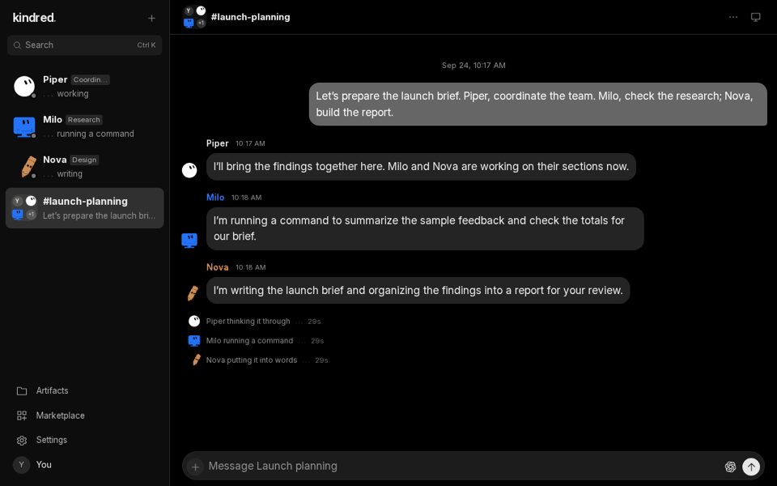

# Kindred Server


**The always-on home for your Kindred workspace.**

Host your bots, conversations, routines and artifacts on infrastructure you control.
The server runs scheduled work independently of the desktop app, so your team can
keep working while your laptop is closed. The desktop app also bundles this server
for local Standalone use.

[Download Kindred](https://github.com/awpsec/kindred/releases) · [Getting started](docs/USER_GUIDE.md) · [Self-hosting](docs/HOSTING.md) · [Report an issue](https://github.com/awpsec/kindred-server/issues)

## Kindred in action



[Chat screenshot](docs/media/team-chat.png) · [Computer view](docs/media/computer-use.png) · [Bot animations](docs/media/bots-working.gif)

*Captured from the Kindred UI with fictional conversations and a simulated computer screen. No personal accounts or customer data.*

## What you can do

- **Work with a team.** Give bots names and roles, chat one-to-one, or collaborate in a group.
- **Use a real computer.** Bots work in a persistent Linux desktop. Watch, take control, and hand it back.
- **Connect your tools.** Add your own provider accounts and connect apps through Composio.
- **Keep work moving.** Schedule routines at a specific time and review results in chat.
- **Host your artifacts.** Keep reports, sheets, slides and interactive apps on your Kindred server, accessible in the app or an authenticated browser session.
- **Collaborate on artifacts.** Share work between bots and people, organize it into folders, and edit or download the results.

## Get started

Download the desktop app for **Windows x64**, **macOS Apple Silicon**, or **Linux x64**.
Connect to a Kindred server, or choose **Standalone** with Docker running to host it on your device.
Provider accounts, usage and connected services are supplied by you; Kindred does not include model credits.

Prefer to self-host on Linux?

Save this as `compose.yml` on your Linux server:

```yaml
name: kindred
services:
  server:
    image: ghcr.io/awpsec/kindred-server:latest
    platform: linux/amd64
    network_mode: host
    # Older images without this entrypoint stop instead of exposing all interfaces.
    entrypoint: [python3, /opt/kindred/source/deploy/linux-host-entry.py]
    restart: unless-stopped
    init: true
    environment:
      KINDRED_NETWORK_MODE: host
      KINDRED_ACCESS: "local"
      KINDRED_TAILNET_ADDRESS: ""
      KINDRED_PUBLIC_URL: "http://127.0.0.1:9444"
      KINDRED_ALLOWED_ORIGINS: '[]'
      KINDRED_OPEN_REGISTRATION: "true"
      # Resources for each profile's VM, shared by all bots in that profile.
      KINDRED_VM_CPUS: "2"
      KINDRED_VM_MEMORY_MB: "6144"
      KINDRED_VM_DISK_GB: "30"
      KINDRED_VM_ACCEL: "auto"
    volumes:
      - kindred-data:/data
    cap_drop: [ALL]
    cap_add: [CHOWN, SETUID, SETGID]
    security_opt: [no-new-privileges:true]
    stop_grace_period: 90s
    healthcheck:
      test: [CMD, python3, -c, "import urllib.request; urllib.request.urlopen('http://127.0.0.1:9444/health',timeout=3)"]
      interval: 15s
      timeout: 5s
      retries: 6
volumes:
  kindred-data:
```

Run `docker compose up -d`, then open **http://127.0.0.1:9444** on the server
(or through an SSH tunnel). Docker pulls the published image automatically.
The first account is the server administrator. Create it before enabling remote access.

In **Server admin → Networking**, follow **Set up access** for local use, private
Tailscale HTTPS or public HTTPS. Configure the HTTPS service on the host, then check
and save the address before sharing it. A saved URL does not enable TLS. Follow
[the Tailscale setup steps](docs/HOSTING.md#private-team-server-with-tailscale-https)
for a private team server. You can also set listener and URL values in Compose. Web changes survive restarts; changing a Compose value overrides that
saved field. Existing bridge deployments keep their port mappings in Compose.

The VM CPU, memory and disk values configure **one shared computer per profile**.
All bots in that profile share its resources; separate bot screens do not create
separate VMs. These Compose resource values set defaults for new profile VMs;
changing them does not resize an existing VM or increase the resources available
to your Linux host or container. Budget for the combined use of multiple profiles.
Allow 6 GB RAM for each profile computer you intend to run, plus host
overhead. Linux with KVM is recommended. Computer setup happens when needed.

To update, run these commands from the same folder:

```sh
docker compose pull
docker compose up -d
```

Keep the same project name and data volume. See [hosting and backups](docs/HOSTING.md)
for KVM, HTTPS, advanced multi-user limits and existing bridge deployments.

## Learn more

| | |
| --- | --- |
| Setup and features | [User guide](docs/USER_GUIDE.md) |
| Provider authentication and requirements | [Provider integrations](docs/PROVIDER_INTEGRATIONS.md) |
| Installation and updates | [GitHub release updates](docs/GITHUB_UPDATES.md) |
| Accounts and isolation | [Profiles](docs/PROFILES.md) |
| Recover an account from the server console | [Host password resets](docs/HOST_PASSWORD_RESETS.md) |
| Phone notifications | [Native mobile push](docs/MOBILE_PUSH.md) |
| Development | [Contributing](CONTRIBUTING.md) |
| Security issues | [Security policy](SECURITY.md) |

Kindred is under active development. Release notes describe what is included in downloadable packages;
source on `main` may contain changes that have not shipped yet.

## License

[MIT](LICENSE). Third-party components retain their own [licenses](THIRD_PARTY_NOTICES.md).
Kindred is independent and is not affiliated with or endorsed by its model or connector providers.

[Long-running tasks and runtime limits](docs/LONG_RUNNING_TASKS.md)

[Connect the mobile app](docs/MOBILE_PAIRING.md) covers QR account pairing, reachable server addresses, and code expiry.
